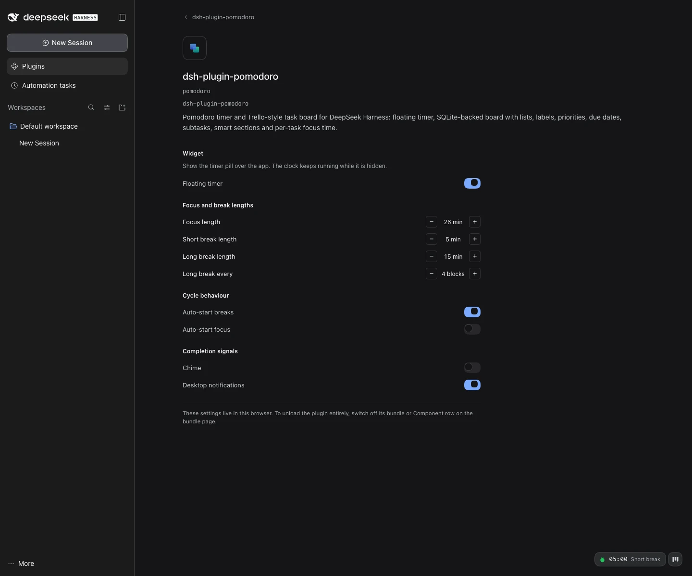
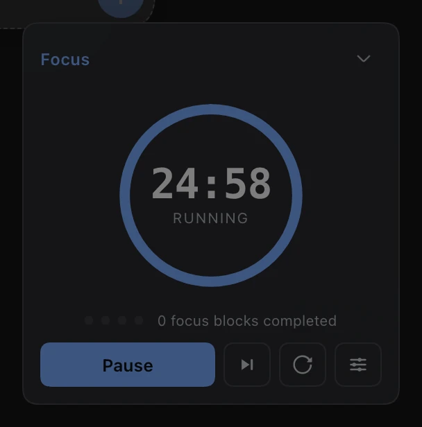
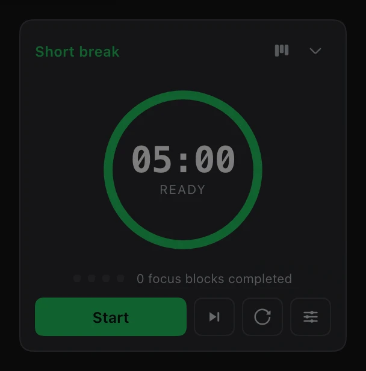
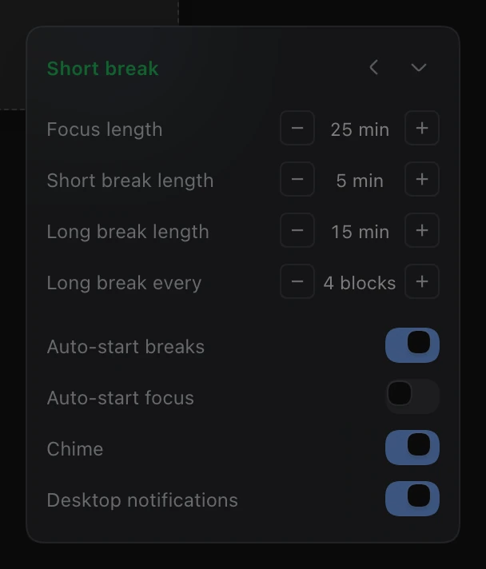

# dsh-plugin-pomodoro

A Pomodoro focus timer for **DeepSeek Harness** — a live countdown that floats over the app so
the clock stays visible while you work.



It is a **browser-only DSH client plugin**: one entry in the frame-wide `shell.overlay` slot. It
registers no tool, prompt, frame, or host service, so it cannot change what the model sees.

| Collapsed | Expanded | Running |
|---|---|---|
|  |  |  |

| Short break | Settings |
|---|---|
|  |  |

| Plugins → Configure |
|---|
|  |

## What you get

- **Collapsed pill** — tomato, remaining time, phase name, and a pulse while the clock runs.
  Click it to open the timer.
- **Focus / short break / long break cycle** — 25/5/15 by default, long break every 4 completed
  focus blocks. Cycle dots track your position; the ring is phase-colored (blue focus, green short
  break, amber long break).
- **Controls** — start, pause, resume, skip, reset, and a settings panel with duration steppers and
  four switches (auto-start breaks, auto-start focus, chime, notifications).
- **Keyboard** — `Space` start/pause, `S` skip, `R` reset, `Esc` collapse — but never while you are
  typing in the composer.
- **Honest clock** — the timer stores an absolute deadline instead of decrementing a counter, so a
  throttled tab, a sleeping laptop, or a reload cannot drift it. Phases that ended while you were
  away are replayed once, not machine-gunned.
- **Persistent state** — phase, remaining time, cycle progress, open panel and settings survive a
  reload, and stay in sync across windows through `localStorage`.
- **Completion signals** — optional two-note chime, optional desktop notification, and an inline
  banner when a phase ends.
- **Themed by tokens** — every color, border and shadow is a `--dsw-*` design token, including the
  blurred "material" menu surface, so light/dark mode and future themes need no second code path.
- **Localized** — English and Chinese dictionaries in the plugin's `pomodoro` locale namespace.

## Enable, disable, configure — in the Plugins page

The plugin is a first-class profile plugin, so **Plugins** (sidebar) → *Installed plugins* →
`dsh-plugin-pomodoro` gives two levels of control:

- **Profile level** — the **enable switch on the bundle card** turns the whole layer on/off, and the
  **Component switch** on the bundle page unloads/reloads just this plugin's row. These are DSH's
  own controls: the Component switch writes `- id: pomodoro / disabled: true` into the profile's
  `cordis.patch.yml` and the plugin unloads live on a profile with HMR. A page refresh is not needed
  for this; only installing the package in the first place needs an app restart.
- **Plugin level** — **Configure** opens this plugin's own page, where *Floating timer* hides/shows
  the widget without unloading the plugin, and the focus/break lengths, cycle behaviour and
  completion signals all live. These write the same record the widget reads, so a running clock is
  never disturbed, and changes made in either surface appear in the other immediately.

The Configure preferences are per browser (`localStorage`); the profile switches are persistent
profile edits.

## Install (already done on this machine)

The plugin is installed in the desktop profile at
`~/.dsh/profiles/desktop/package.json` — dependency plus bundle entry — with timestamped backups
of the two edited manifest files. **Restart DeepSeek Harness to load it**: a page refresh is not
enough, because the Electron window captures host boot injections once at Host start.

From scratch, the install is one command with the app's bundled CLI:

```bash
APP_CLI="/Applications/DeepSeek Harness.app/Contents/Resources/runtime/cli/bin/dsh"
"$APP_CLI" plugin --profile desktop add "link:/path/to/pomodoro-plugin" --offline
```

`dsh-plugin-pomodoro` declares `dsh.bundle.patch`, so the command adds both the dependency and the
`dsh.profile.bundles` entry; the bundle's own `cordis.patch.yml` inserts the loader row. See
[docs/install.md](docs/install.md) for the full recipe, rollback, and the version-specific details
(URL scheme, restart semantics, log locations).

## Verify

```bash
node scripts/build.mjs --check      # lib/client.js is up to date with src/
node --test tests/*.test.js         # 29 core + bundle tests
./scripts/verify-plugin.sh          # isolated DSH 0.2.1 instance: install → boot → bundle served
node scripts/verify-ui.mjs --url <authenticated-url> --cdp http://127.0.0.1:9333 \
  --out /tmp/shots                  # headless-Chrome end-to-end: 49 checks + screenshots
```

Current evidence: 29/29 tests, `verify-plugin.sh` PASS, 49/49 UI checks against a throw-away
DSH 0.2.1-rc.2 instance (including the Plugins page, the Configure page, and the Component switch
unloading/reloading the plugin). Details: [docs/verification.md](docs/verification.md).

## Configure

The loader row accepts an optional config; `defaults` only seeds the initial state, the user's own
choices in the settings panel win afterwards:

```yaml
- insert:
    - id: pomodoro
      name: dsh-plugin-pomodoro
      config:
        storageKey: dsh-plugin-pomodoro:state:v1   # isolate a second instance
        defaults:
          focusMin: 50
          shortBreakMin: 10
          longBreakMin: 20
          longBreakEvery: 2
          autoStartBreaks: true
          autoStartFocus: false
          sound: true
          notify: true
```

## Layout

```
src/timer-core.js    pure state machine (phases, deadlines, catch-up, settings)
src/locales.js       en + zh dictionaries
src/client.js        React widget, Plugins configuration page + cordis plugin body
lib/client.js        GENERATED browser bundle (what the host serves)
lib/index.js         host half: opens the board SQLite database and publishes its /api routes
lib/db.js            SQLite schema, migrations, board commands, export/import, backups
lib/api.js           authenticated board HTTP routes (state, command, export, import)
scripts/build.mjs    inlining build (local imports + require rewriting)
scripts/verify-plugin.sh  isolated static + live install/boot check
scripts/verify-ui.mjs     CDP-driven end-to-end UI check + screenshots
tests/               node:test suites for the core and the built bundle
docs/                client API spec, install recipe, verification evidence
```

## Design notes

- **Host half owns the task board data.** The loader entry is what makes the client module system
  scan the package, and the host half uses it to keep the board in SQLite
  (`$DSH_HOME/pomodoro/board.sqlite`) behind five authenticated exact routes
  (`/api/pomodoro-board/…`). The browser half only renders and edits through them — no board data
  lives in `localStorage`. Profiles without a `connection` service load the plugin inert (headless).
- **Hand-written bundle.** `lib/client.js` is committed and consumed straight from the package, so
  installing needs no build tool. `scripts/build.mjs` only inlines the `src/` modules and rewrites
  `react` imports into the factory's `require`, mirroring how DSH's own client plugins are shipped.
- **One external dependency: `react`** (the shell's singleton). Icons are drawn locally so the
  bundle stays independent of `@deepseek-ai/*` internals that may change between releases.
- **Wall-clock state machine.** `src/timer-core.js` is framework-free and unit-tested; the widget
  owns only the clock, storage, notifications and copy.

## License

MIT
