# dsh-plugin-pomodoro

A **Pomodoro timer plus a Trello-style task board** for **DeepSeek Harness** — the timer floats over
the app, the board lives in the same overlay, and the focus time you spend is credited to the task
you are working on.

The plugin has two halves: a browser-only client (the floating timer and the board UI) and a small
host half that stores the board in **SQLite** under your DSH home and exposes it through five
authenticated routes. Nothing here reaches the model: no tools, prompts, session events, or provider
requests.

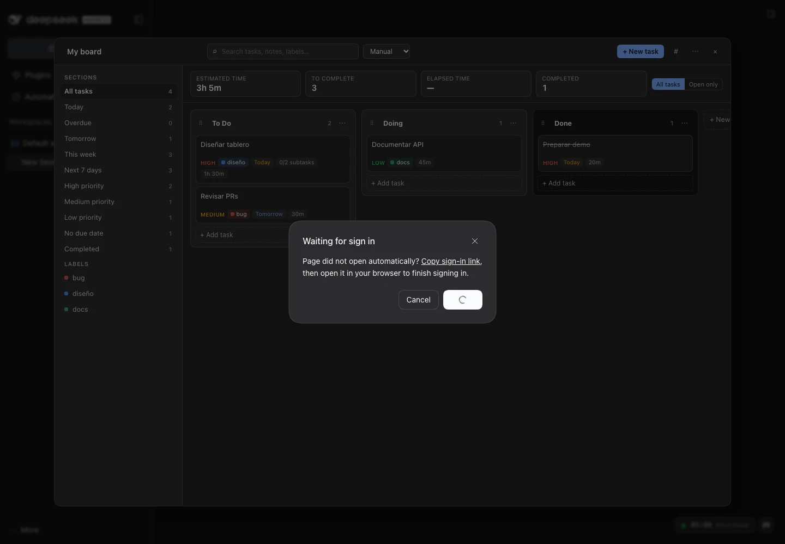

## Features

### Focus timer
- Floating pill in the shell overlay with the countdown, phase and pulse; expands into a card with
  ring progress, cycle dots, start/pause/skip/reset and settings.
- Focus / short break / long break cycle (25/5/15 by default, long break every 4 focus blocks).
- Keyboard: `Space` start/pause, `S` skip, `R` reset, `Esc` collapse, `B` open/close the board.
- Optional chime, desktop notifications and inline completion banner.
- The clock stores an absolute deadline, so reloads, throttled tabs and sleep do not drift it.

### Task board (Trello-style)
- **Custom lists** (To Do / Doing / Done by default): create, rename inline, reorder by dragging,
  mark a list as the completion list, delete with task reassignment.
- **Cards** with priority (none/low/medium/high), colored labels, due date, estimate, notes,
  subtasks, tracked time and pomodoro count.
- **Full composer** (all fields plus subtask rows before creating) and a **task drawer** for
  everything afterwards, including subtask checklists and label assignment.
- **Drag & drop** cards between columns with an insertion line; drag list handles to reorder
  columns. Accessible alternatives: the card's “Move to list” menu and `Alt+←/→/↑/↓` on a focused
  card.
- **Smart sections** in the rail with live counts: All tasks, Today, Overdue, Tomorrow, This week,
  Next 7 days, High/Medium/Low priority, No due date, Completed.
- **Four per-section metrics**: Estimated time, To complete, Elapsed time, Completed — with an
  estimate-scope toggle (all tasks / open tasks only).
- **Search** across titles, notes, subtasks and label names (accent-insensitive) plus **label
  filters**, and manual / due / priority / creation ordering.
- **JSON export and import** of the whole board with a validated confirmation step.

### Focus minutes that add up
- **Focus** on a card or in the drawer links the task to the timer.
- The plugin measures **real focus time** (pause, reset, skip, switching tasks and phase completion
  all settle the segment) and credits it to the task; a completed focus phase adds one pomodoro.
- Credits are **idempotent** (`creditId`) and queue locally when the host is unreachable, so a
  reload or a retried request never double-counts.
- Phases that finished while the app was closed are replayed on the next load.

| Today section with metrics | Task drawer | Composer |
|---|---|---|
| 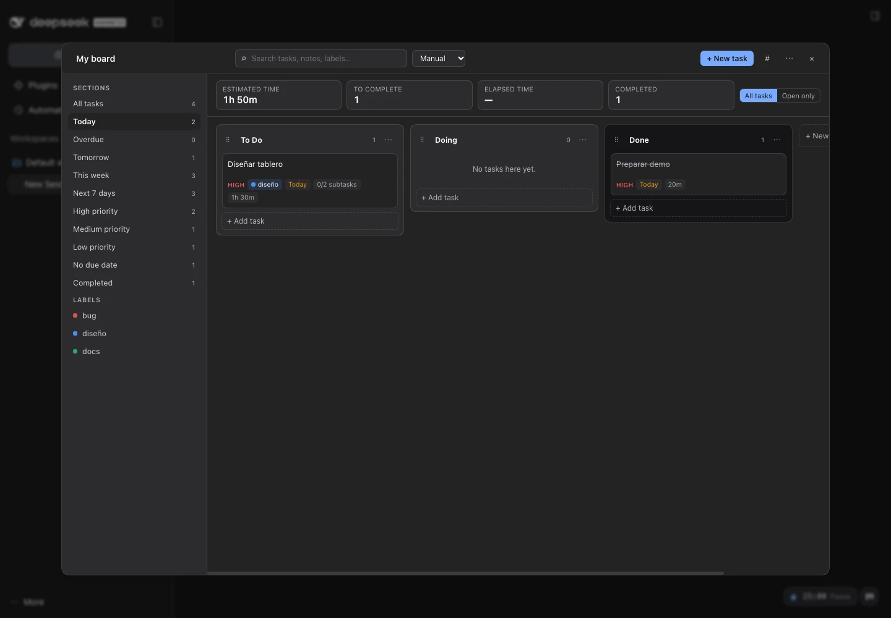 | 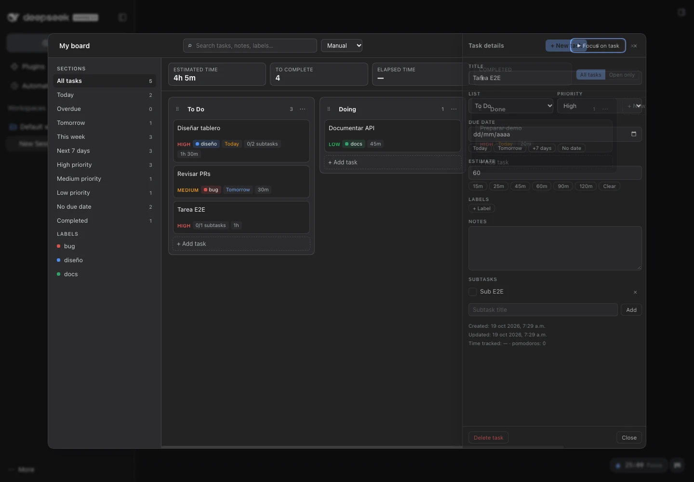 | 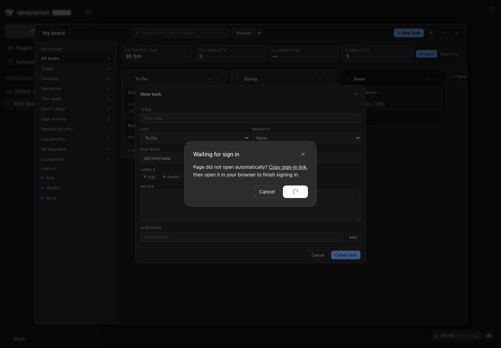 |

| Task focused by the timer | Board menu | Import confirmation |
|---|---|---|
| 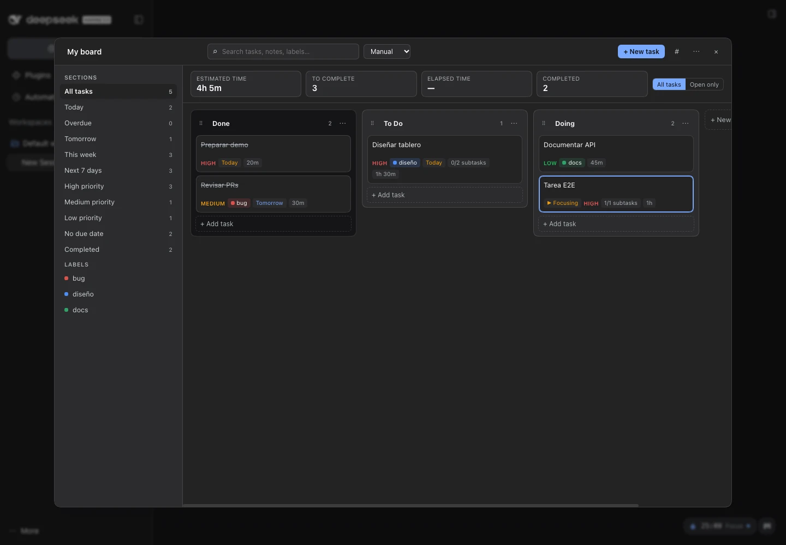 | 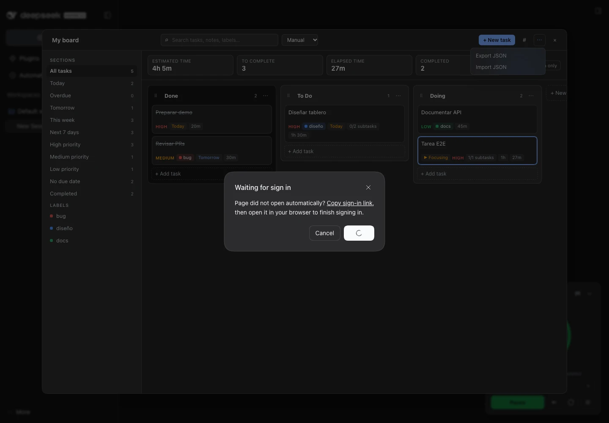 | 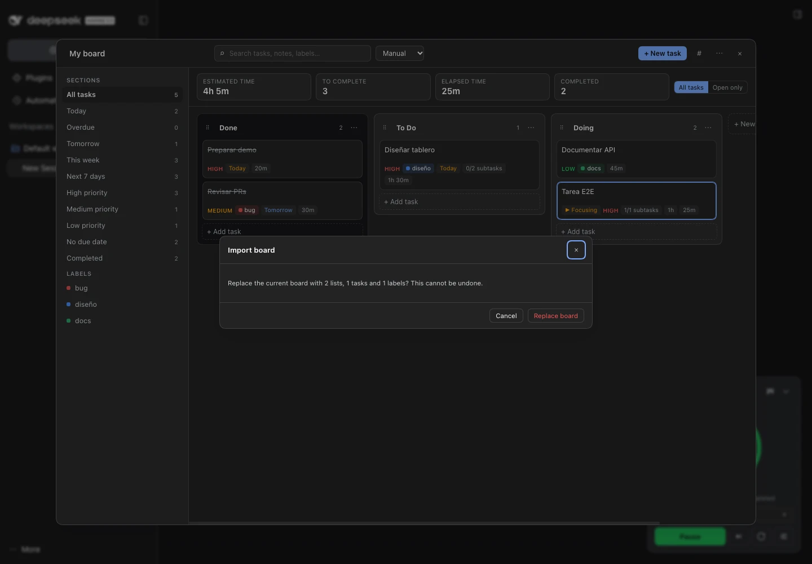 |

| Inline label panel in the drawer | Label manager |
|---|---|
| 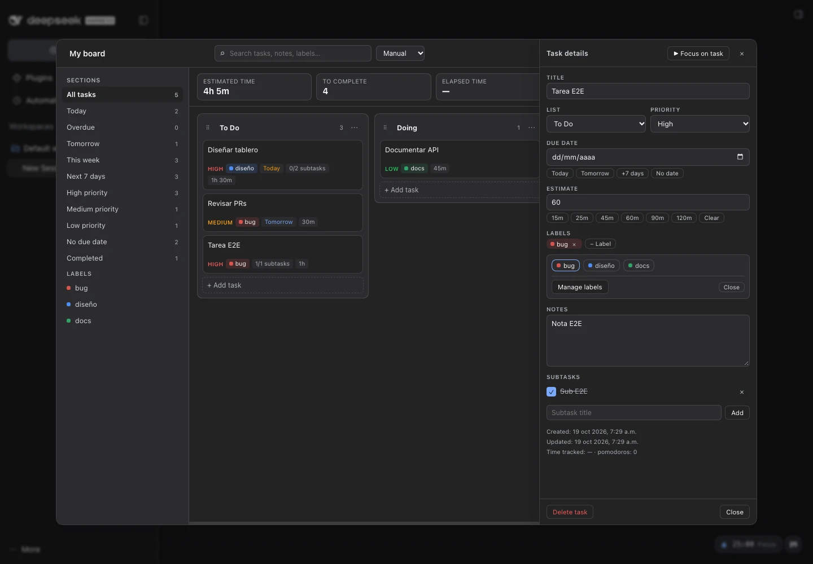 | 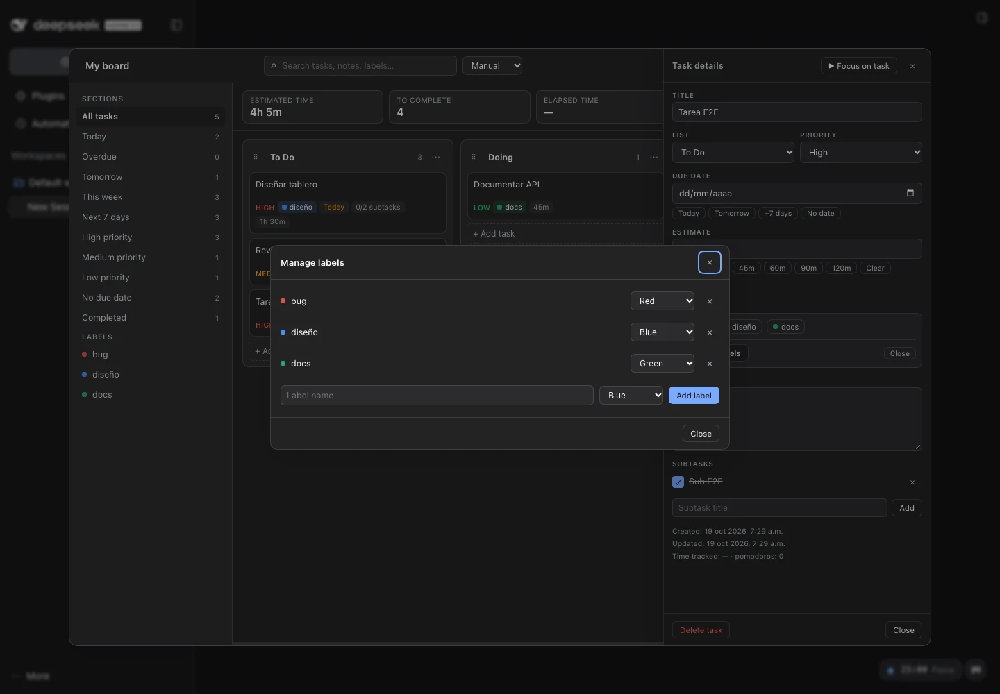 |

The timer widget and its Plugins configuration page are unchanged:

| Collapsed | Expanded | Plugins → Configure |
|---|---|---|
| 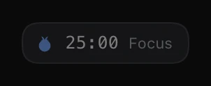 |  | 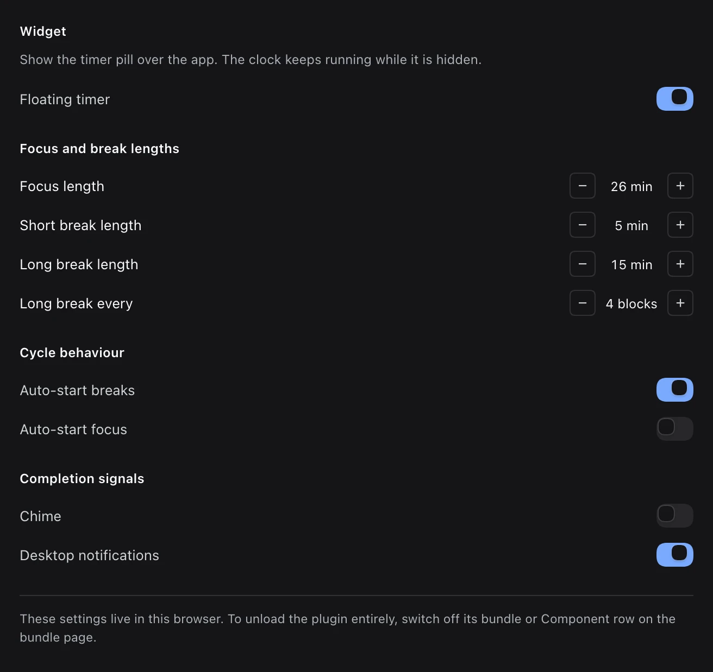 |

## Enable, disable, configure — in the Plugins page

**Plugins** (sidebar) → *Installed plugins* → `dsh-plugin-pomodoro`:

- **Profile level** — the bundle switch and the **Component** switch (writes
  `- id: pomodoro / disabled: true` into the profile's `cordis.patch.yml`, unloading the plugin live
  on a profile with HMR).
- **Plugin level** — **Configure** hides/shows the timer widget and edits its defaults. Board data is
  not affected by those switches.

## Install (already done on this machine)

```bash
APP_CLI="/Applications/DeepSeek Harness.app/Contents/Resources/runtime/cli/bin/dsh"
"$APP_CLI" plugin --profile desktop add "link:/path/to/pomodoro-plugin" --offline
```

`dsh-plugin-pomodoro` declares `dsh.bundle.patch`, so the command adds both the dependency and the
`dsh.profile.bundles` entry. Restart DeepSeek Harness once to load the plugin in the desktop window.
See [docs/install.md](docs/install.md) for the full recipe, rollback, version-specific details and
the log locations.

## Storage

- **Board data → SQLite** at `$DSH_HOME/pomodoro/board.sqlite` (WAL; `config.dbPath` overrides it).
  A daily rotating backup is written to `board.sqlite.bak` (plus `.bak.1` … `.bak.7`).
- **Per-window presentation** (active section, search, label filter, ordering) → `localStorage`.
- **Timer record and widget preferences** → `localStorage` (`dsh-plugin-pomodoro:state:v1`,
  `:prefs:v1`, `:ui:v1`); pending focus credits are queued in `:pending-credits:v1`.

See [docs/board.md](docs/board.md) for the data model, HTTP routes and limits.

## Verify

```bash
node scripts/build.mjs --check      # lib/client.js is up to date with src/
node --test tests/*.test.js         # 95 unit/integration tests (core, stores, host SQLite + API)
./scripts/verify-plugin.sh          # isolated DSH 0.2.1: install → boot → bundle + board host
node scripts/verify-board.mjs --url "<authenticated-url>"   # headless board E2E (22 checks)
```

Current evidence: **95/95 tests**, `verify-plugin.sh` PASS (bundle served + `/api/pomodoro-board`
200 + SQLite file created), **22/22 board E2E checks** against a throw-away DSH 0.2.1-rc.2 instance.
Details and commands: [docs/verification.md](docs/verification.md).

## Configure

The loader row accepts optional configuration:

```yaml
- insert:
    - id: pomodoro
      name: dsh-plugin-pomodoro
      config:
        dbPath: /custom/path/board.sqlite   # default: $DSH_HOME/pomodoro/board.sqlite
        storageKey: dsh-plugin-pomodoro:state:v1
        defaults:                            # timer defaults only (the user's UI wins afterwards)
          focusMin: 25
          shortBreakMin: 5
          longBreakMin: 15
          longBreakEvery: 4
          autoStartBreaks: true
          autoStartFocus: false
          sound: true
          notify: true
```

## Layout

```
lib/index.js          host half: opens SQLite, registers the board routes in ctx.effect
lib/db.js             schema v1, migrations, commands, export/import, rotating backup
lib/api.js            authenticated board routes (state, revision, command, export, import)
lib/client.js         GENERATED browser bundle (what the host serves)
src/timer-core.js     pure timer state machine (deadlines, phases, focus accounting)
src/tasks-core.js     pure board rules (sections, metrics, search, ordering)
src/board-store.js    board API bridge, observable snapshots, credit queue, focus bridge
src/board-ui.js       board overlay (columns, cards, stats, drawer, composer, menus)
src/board-styles.js   board stylesheet (design tokens only)
src/locales.js        en + zh dictionaries
src/client.js         React widget, Plugins page + cordis client plugin body
scripts/build.mjs     inlining build (local imports + require rewriting)
scripts/verify-plugin.sh  isolated install/boot/bundle/board-host check
scripts/verify-ui.mjs     CDP end-to-end for the timer widget and Plugins page
scripts/verify-board.mjs  CDP end-to-end for the task board
tests/                node:test suites
docs/                 client API spec, board guide, install recipe, verification evidence
```

## Design notes

- **Host owns the data.** Board state is human knowledge, not conversation state: SQLite, WAL,
  transactional commands and idempotent time credits keep it durable and consistent, while the
  browser stays a thin, replaceable view.
- **One authenticated surface.** Five exact routes ride DSH's connection carrier: HTTP + cookie in
  the web app, and the desktop shell's `dsh-app://` proxy (same cookie) in Electron.
- **Hand-written bundle.** `lib/client.js` is committed and served straight from the package, so
  installing needs no build tool. `scripts/build.mjs` only inlines the `src/` modules and rewrites
  `react` imports into the factory's `require`.
- **Measured, not nominal, focus time.** Segments are wall-clock derived and settled on every
  transition, and `creditId`s make retries safe.

## Known limitations

- One board per DSH home; no sharing or multi-device sync. Use JSON export/import to move boards.
- Data lives on the host that owns the profile: two different DSH installations do not share a board.
- Drag & drop uses the pointer; keyboard/menu alternatives are the accessible path.
- Tested on macOS with DSH 0.2.1-rc.2; Windows/Linux are unverified.

## License

MIT — see [LICENSE](LICENSE).
